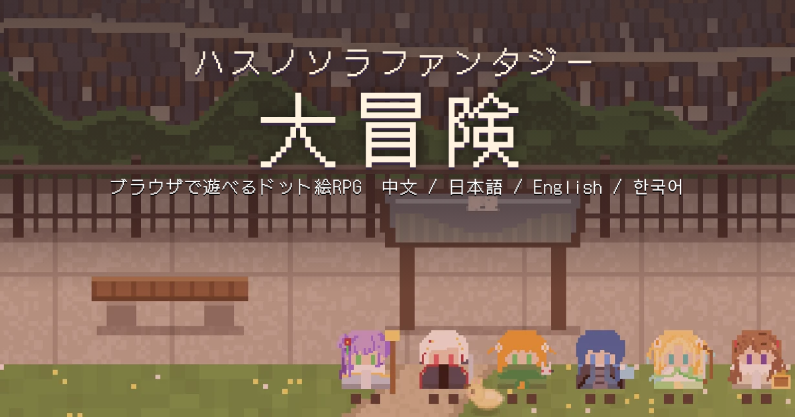

# ハスノソラファンタジー大冒険
### Hasunosora Fantasy: Grand Adventure

**▶ Play / 遊ぶ / 開始遊玩：https://wherezu.github.io/hasunosora-fantasy-adventure/**

📱 スマホでもPCでも遊べます ／ 手機、電腦都能玩 ／ Playable on phone and PC

日本語 ／ 中文 ／ English ／ 한국어（機械翻訳）

---

## 日本語

蓮ノ空の二次創作ブラウザゲームです。金沢を舞台にしたドット絵RPGで、ブラウザを開くだけで、スマホでもPCでもすぐ遊べます。

- クリア後はパーティを選んで金沢を自由に散歩できます
- 二人を選ぶと、デートやお泊まり、温泉も楽しめます
- ストーリーは短めです

**操作**：方向キーで移動（Shiftでダッシュ）／Z・Enterで調べる・決定／X・Escでメニュー・キャンセル／Gで目的地ガイド／Mで全体マップ。スマホは画面のボタンをタップして操作できます。

**セーブについて**：セーブデータはブラウザに保存されます。別の端末やブラウザで続きを遊びたいときは、メニューの「セーブ」→「セーブコードを書き出す」でコードをコピーし、移動先のタイトル画面の「セーブコードを読み込む」に貼り付けてください。

## 中文

蓮ノ空的同人網頁小遊戲，以金澤為舞台的像素 RPG，手機、電腦打開瀏覽器就能玩。

- 通關後可以選隊伍的人自由逛金澤
- 選兩個人可以約會、一起睡覺、泡溫泉
- 劇情蠻短的

**操作**：方向鍵移動（按住 Shift 跑步）／Z・Enter 調查・決定／X・Esc 選單・取消／G 目的地導引／M 全地圖。手機用畫面上的按鈕點觸操作。

**存檔**：存檔存在瀏覽器裡。想換裝置或換瀏覽器繼續玩，可以在選單「存檔」→「匯出存檔碼」複製一串文字，再到新裝置的標題畫面選「匯入存檔碼」貼上。

## English

A fan-made browser RPG based on Hasunosora (Link! Like! Love Live!), set in Kanazawa and drawn in pixel art. No download needed — just open the link on your phone or PC.

- After clearing the story, pick your party and wander around Kanazawa freely
- Choose two characters to go on dates, stay overnight, or visit the hot springs
- The story is fairly short

**Controls**: Arrow keys to move (hold Shift to run) / Z or Enter to examine & confirm / X or Esc for menu & cancel / G for the destination guide / M for the full map. On phones, use the on-screen touch buttons.

**Saves**: Save data is stored in your browser. To continue on another device or browser, open Menu → Save → "Export Save Code", copy the code, then choose "Import Save Code" on the title screen of the new device and paste it.

---

## Safety / 安全性 / 安全性

The whole game is a single HTML file — nothing to install.
ゲームはHTMLファイル1つだけで、インストールは不要です。
遊戲只有一個 HTML 檔案，不需要下載安裝。

VirusTotal scan: [0 / 93 detections](https://www.virustotal.com/gui/url/4a6329a50df73d87a41d126339cc4ed763851a2be9907b193eb97c47c4285e09)

## Credits

- 作者 / Author：小狗カ(111panda11112)
- ドット絵キャラクター・メインシナリオ / 角色點陣圖・主線劇情 / Character sprites & main story：小狗カ
- プログラム・背景 / 程式・背景 / Code & backgrounds：Claude (Anthropic)

本作は非公式のファン作品で、公式とは一切関係ありません。
本作為非官方同人作品，與官方無關。
This is an unofficial fan work and is not affiliated with the official project.
